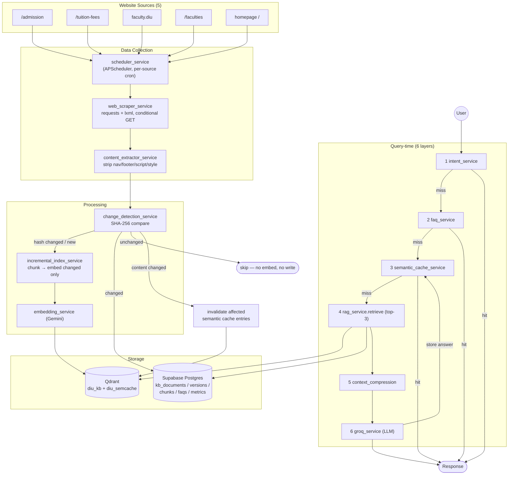
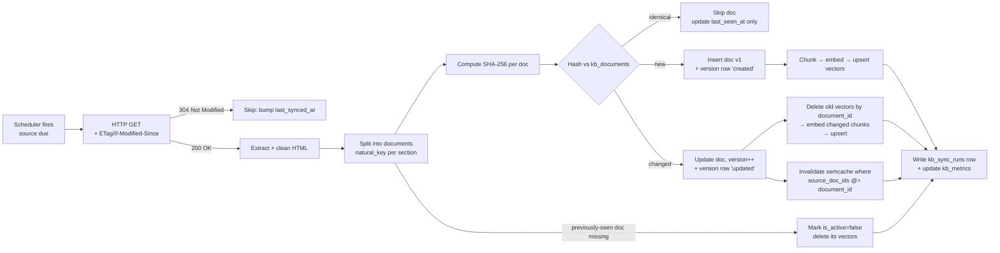
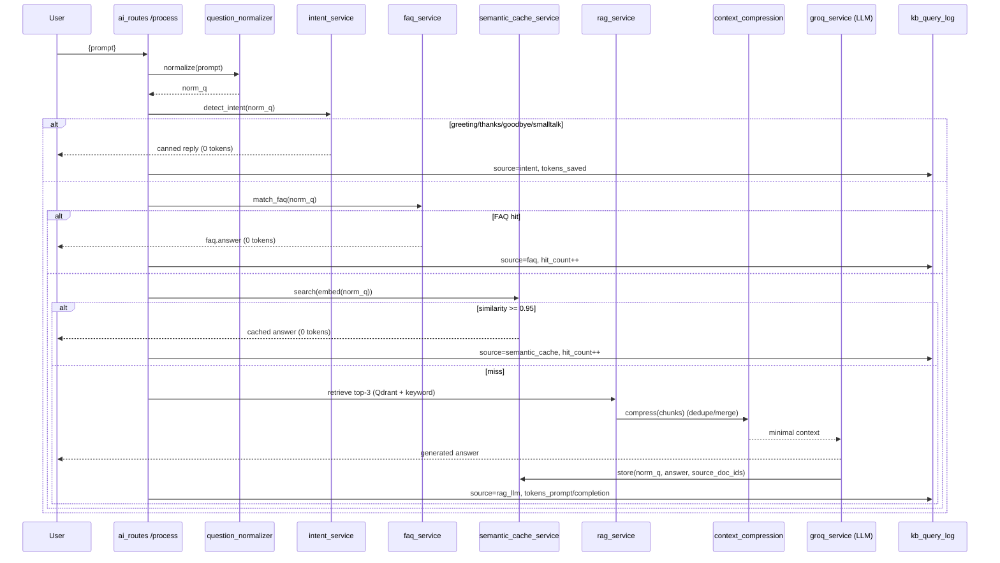

# DIU AI Knowledge Pipeline & RAG System — Design (Phase 0)

> **Status:** Design of record, awaiting approval before implementation.
> **Stack decision:** Extend the existing **Python / Flask** AI microservice
> (`backend-python`) — NOT a parallel Node.js build. Reuses the deployed Groq +
> Gemini + Qdrant + Supabase infrastructure. See "Mapping to the spec" below for
> how each requested Node.js component maps to a Python-native equivalent.

---

## 0. Why this design (context)

The spec reads as a greenfield Node.js/Prisma/BullMQ template, but this project
already ships a **deployed** Flask AI service on Render that implements ~60% of
the requirement. This design **adds the missing 40%** on top of what exists,
rather than rebuilding:

| Spec component (Node.js) | Python-native equivalent used here | Status |
|---|---|---|
| Node.js + Express | **Flask** (`backend-python`) | exists |
| Prisma ORM + schema | **SQL DDL** (`supabase/migrations/…_ai_knowledge_pipeline.sql`) + SQLAlchemy models | schema written ✅ |
| PostgreSQL | **Supabase Postgres** (same DB the Spring service uses) | exists |
| Qdrant | **Qdrant Cloud** (`vector_store_service.py`) | exists |
| Redis + BullMQ | **APScheduler** in-process + Redis-optional `cache_service` (falls back to in-proc) | new |
| Playwright/Puppeteer + Cheerio | **requests + BeautifulSoup/lxml** (`web_scraper_service.py`) | exists, extend |
| OpenAI embeddings | **Gemini embeddings** (`embedding_service.py`) | exists |
| LLM (configurable) | **Groq** llama-3.3-70b (`groq_service.py`) | exists |

> **Playwright note:** all 5 target pages are server-rendered HTML; `requests` +
> `lxml` already extracts them. Playwright (headless browser) is only added later
> **if** a source turns out to be JS-rendered — kept behind a `render_js` flag on
> `kb_sources` so we don't pay the browser cost by default.

---

## 1. Folder structure

New files are marked **NEW**; everything else already exists and is extended.

```
backend-python/
├── main.py                                  # app entry (gunicorn)
├── requirements.txt                         # + apscheduler, psycopg[binary], redis (optional), tiktoken
├── AI_KNOWLEDGE_PIPELINE.md                 # NEW — this document
├── app/
│   ├── __init__.py                          # create_app(): registers blueprints + starts scheduler
│   ├── config/
│   │   └── settings.py                      # + pipeline env vars (DATABASE_URL, REDIS_URL, intervals…)
│   ├── db/                                  # NEW — Supabase/Postgres access layer
│   │   ├── __init__.py
│   │   └── pg.py                            # NEW — psycopg connection pool + query helpers
│   ├── models/
│   │   └── kb_models.py                     # NEW — SQLAlchemy mirror of the kb_* schema (typed access)
│   ├── repositories/                        # NEW — data-access per table (thin, testable)
│   │   ├── sources_repo.py                  # NEW
│   │   ├── documents_repo.py                # NEW  (upsert + version + hash compare)
│   │   ├── chunks_repo.py                   # NEW
│   │   ├── faq_repo.py                       # NEW
│   │   ├── semcache_repo.py                 # NEW
│   │   ├── metrics_repo.py                  # NEW
│   │   └── sync_repo.py                      # NEW  (sync_runs + event_log)
│   ├── services/
│   │   ├── web_scraper_service.py           # EXTEND — add admission/faculties/homepage parsers + conditional GET
│   │   ├── content_extractor_service.py     # NEW — clean/normalize HTML → structured docs (shared cleaner)
│   │   ├── change_detection_service.py      # NEW — SHA-256 compare, decides skip/insert/update/deactivate
│   │   ├── embedding_service.py             # EXTEND — no change needed; called incrementally
│   │   ├── vector_store_service.py          # EXTEND — add delete_by_document, ensure_payload_index, uuid ids
│   │   ├── incremental_index_service.py     # NEW — orchestrates chunk→embed→delete-old→upsert-new per doc
│   │   ├── sync_service.py                  # NEW — per-source pipeline: fetch→extract→detect→index→invalidate
│   │   ├── scheduler_service.py             # NEW — APScheduler; per-source intervals; single-run lock
│   │   ├── intent_service.py                # NEW — Layer 1 (greeting/thanks/goodbye/smalltalk)
│   │   ├── faq_service.py                   # NEW — Layer 2 (structured FAQ match)
│   │   ├── semantic_cache_service.py        # NEW — Layer 3 (Qdrant semcache, >=95% match)
│   │   ├── question_normalizer.py           # NEW — normalize before every lookup
│   │   ├── context_compression_service.py   # NEW — Layer 5 (dedupe/merge overlapping chunks)
│   │   ├── cache_service.py                 # NEW — Redis-optional KV + counters (in-proc fallback)
│   │   ├── rag_service.py                   # EXTEND — retrieve() top-3 + compression; build_index kept for full rebuild
│   │   ├── keyword_search_service.py        # exists (fused keyword layer)
│   │   ├── groq_service.py                  # EXTEND — chat pipeline calls layers 1→6; logs tokens
│   │   ├── ingestion_service.py             # exists (PDF/OCR)
│   │   └── knowledge_base_service.py        # exists
│   └── routes/
│       ├── ai_routes.py                     # EXTEND — /process runs the 6-layer pipeline
│       ├── pipeline_routes.py               # NEW — sync / rebuild / search / cache / status
│       ├── admin_routes.py                  # NEW — dashboard metrics
│       ├── live_data_routes.py              # exists
│       ├── ingestion_routes.py              # exists
│       └── health_routes.py                 # exists
└── scripts/
    ├── seed_faqs.py                         # NEW — load starter FAQ set
    └── bootstrap_pipeline.py                # NEW — first full crawl + index
```

---

## 2. System architecture diagram



---

## 3. Data flow diagram (sync path)



---

## 4. Sequence diagram — synchronization

```mermaid
sequenceDiagram
    participant SCH as scheduler_service
    participant SYN as sync_service
    participant WEB as web_scraper_service
    participant CHG as change_detection_service
    participant PG as Supabase
    participant EMB as embedding_service
    participant QD as Qdrant
    participant SEM as semantic_cache_service

    SCH->>SYN: run_source(source_id)  (interval elapsed + lock acquired)
    SYN->>PG: INSERT kb_sync_runs (status=running)
    SYN->>WEB: fetch(url, etag, last_modified)
    alt 304 Not Modified
        WEB-->>SYN: not_modified
        SYN->>PG: UPDATE last_synced_at; sync_run=success (0 changes)
    else 200 OK
        WEB-->>SYN: html + new etag
        SYN->>WEB: extract → [documents]
        loop each document
            SYN->>CHG: compare(natural_key, sha256)
            alt unchanged
                CHG->>PG: UPDATE last_seen_at
            else new or changed
                CHG->>PG: upsert doc + version row
                SYN->>QD: delete points where document_id = id
                SYN->>EMB: embed(changed chunks)
                EMB-->>SYN: vectors
                SYN->>QD: upsert(new points)
                SYN->>SEM: invalidate(document_id)
            end
        end
        SYN->>PG: sync_run=success + metrics
    end
```

---

## 5. Sequence diagram — chatbot query (6-layer token optimization)



---

## 6. Module specifications

### 6.1 `content_extractor_service` (extraction + cleaning)
- Shared cleaner (promoted from `web_scraper_service._clean`): drops
  `nav, footer, header, aside, script, style, noscript`, ad/`.banner` blocks.
- Emits **documents**, each with a stable `natural_key = url + "#" + slug(section-heading)`
  so the same section maps to the same DB row across crawls.
- Normalizes whitespace, collapses blank lines, dedupes repeated blocks.
- Returns `[{natural_key, title, category, content, structured_data}]`.

### 6.2 `change_detection_service` (SHA-256)
```
hash = sha256(normalize(content)).hexdigest()
row  = documents_repo.get(source_id, natural_key)
if   row is None            -> action=INSERT   (version 1, 'created')
elif row.content_hash==hash -> action=SKIP     (touch last_seen_at)
else                        -> action=UPDATE   (version+1, 'updated')
# after loop: any active row whose natural_key wasn't seen this run -> DEACTIVATE
```
Only INSERT/UPDATE/DEACTIVATE flow downstream to embeddings. **Unchanged pages
never touch Gemini or Qdrant.** Per-chunk hashing (in `kb_chunks`) means even on
an UPDATE we re-embed only the chunks that actually changed.

### 6.3 `incremental_index_service`
- Chunking reuses `rag_service._chunk_text`.
- Deterministic vector id: `uuid5(NAMESPACE, f"{document_id}:{chunk_index}")` →
  stable across runs, so upsert overwrites in place.
- On UPDATE: `vector_store.delete_by_document(document_id)` then upsert survivors.
- On DEACTIVATE: delete vectors, keep the row (audit) with `is_active=false`.
- Writes `kb_chunks` rows; increments `embeddings_generated` metric.

### 6.4 `vector_store_service` extensions
- `ensure_collection(dim)` — create if absent (no destructive recreate on sync).
- `ensure_payload_index("document_id")` — needed for delete-by-filter.
- `delete_by_document(doc_id)` — `POST /points/delete` with a `document_id` filter.
- `recreate_collection` kept for the admin **full rebuild** path only.
- Second collection `diu_semcache` for the semantic cache.

### 6.5 Token-optimization layers
| Layer | Module | LLM call? | Store |
|---|---|---|---|
| 1 Intent | `intent_service` | no | regex/keyword table |
| 2 FAQ | `faq_service` | no | `kb_faqs` (normalized + keyword GIN) |
| 3 Semantic cache | `semantic_cache_service` | no | Qdrant `diu_semcache` + `kb_semantic_cache` |
| 4 RAG retrieve | `rag_service.retrieve` | no | Qdrant `diu_kb` (top-3, `RAG_TOP_K=3`) |
| 5 Compression | `context_compression_service` | no | — |
| 6 LLM | `groq_service` | **yes** | writes answer back to Layer 3 |

- **Normalization** (`question_normalizer`): lowercase, strip punctuation/extra
  whitespace, expand a small synonym map ("fee"→"tuition fee", "cse"→"computer
  science"), so `"CSE fee"`, `"CSE Fee?"`, `"cse fees"` collapse to one key.
- **Popular questions:** `hit_count` on FAQ + semcache; a nightly job promotes
  entries above `POPULAR_HIT_THRESHOLD` to `is_permanent=true` (never evicted).
- **Cache invalidation:** on doc change, delete semcache rows where
  `source_doc_ids @> ARRAY[document_id]` and remove their Qdrant points. Unrelated
  entries are untouched.

### 6.6 `scheduler_service`
- APScheduler `BackgroundScheduler`, one job per active source at its
  `sync_interval_seconds`.
- **Single-run guard** (gunicorn runs ≥2 workers): acquire a Postgres advisory
  lock (`pg_try_advisory_lock`) keyed per source before running; skip if held.
  With `REDIS_URL` set, a Redis `SET NX EX` lock is used instead.
- Started from `create_app()` (guarded so it starts once), or disabled with
  `SCHEDULER_ENABLED=false` in favor of **Render Cron Jobs** hitting
  `POST /api/v1/pipeline/sync?source=<id>` (production-robust alternative — see §10).

---

## 7. API endpoints

Base: `/api/v1`

| Method | Path | Purpose |
|---|---|---|
| POST | `/ai/process` | Chat — runs the 6-layer pipeline (extended) |
| POST | `/pipeline/sync` | Sync one source `?source=<id>` or all |
| POST | `/pipeline/rebuild` | Full re-crawl + full Qdrant rebuild (admin) |
| POST | `/pipeline/embeddings/rebuild` | Re-embed all active docs |
| GET | `/pipeline/status` | Sources, last sync, vector count, embedding status |
| GET | `/pipeline/scheduler` | Scheduler jobs + next-run times |
| GET | `/search/documents` | Semantic search over `kb_documents` `?q=` |
| GET | `/search/faq` | FAQ search `?q=` |
| GET | `/cache/semantic` | Inspect semantic cache `?q=` |
| POST | `/cache/invalidate` | Invalidate by `document_id` / `category` / `all` |
| GET | `/admin/dashboard` | All dashboard metrics (see §8) |
| GET | `/admin/sources` | Per-source health + failed pages |
| GET | `/admin/logs` | Recent `kb_event_log` `?category=&level=` |
| GET | `/admin/popular-questions` | Top questions by hit_count |
| GET | `/health/check` | Liveness (exists) |

All responses: `{ "success": bool, "data"|"error": ... }` (matches existing style).

---

## 8. Admin dashboard (metrics served by `/admin/dashboard`)

Website status · last sync time (per source) · sync progress (running run) ·
failed pages (`pages_failed`) · updated pages (`pages_changed`) · vector count
(Qdrant `points_count`) · embedding status · database status · **cache hit ratio**
(`cache_hits/(cache_hits+cache_misses)`) · **tokens saved** · total API calls ·
total LLM calls · most-asked questions · scheduler status. All read from
`kb_metrics`, `kb_sync_runs`, `kb_semantic_cache`, `kb_query_log`, and Qdrant
`collection_info()`. The existing React admin dashboard (`/admin`, recharts) gets
a new "AI Pipeline" tab consuming this endpoint (Phase 3).

---

## 9. Logging & error handling

- **Logging:** Python `logging` to stdout (Render captures it) **plus** a
  `kb_event_log` row for sync/embedding/error/scheduler events via `sync_repo.log()`.
  Categories: scraping, sync, embedding, cache, llm, db, scheduler, error.
- **Error handling / recovery:**
  - HTTP fetch: 3 retries w/ exponential backoff (already in `embedding_service`;
    same pattern for scraper). `consecutive_failures` on `kb_sources`; a source is
    "down" after N fails and logged, but never blocks other sources.
  - Duplicate prevention: `UNIQUE(source_id, natural_key)` + upsert.
  - Website downtime: 304/timeout/5xx → skip cleanly, keep last-known data.
  - Embedding/Qdrant failure mid-sync → `sync_run.status='partial'`, retried next tick.
  - Query pipeline degrades gracefully (already does): if RAG/Qdrant down, falls
    back to keyword layer, then legacy static prompt — chat never hard-breaks.

---

## 10. Deployment (Render) & environment

**Runs inside the existing `diu-ai-service`** (gunicorn). Two scheduler options:

- **Default:** in-process APScheduler with advisory-lock single-run guard.
  Set gunicorn `--workers 2 --timeout 120`; only one worker runs each job.
- **Production-robust (recommended for free tier that spins down):** set
  `SCHEDULER_ENABLED=false` and add **Render Cron Jobs** in `render.yaml`:
  - every 5 min → `POST /api/v1/pipeline/sync?category=homepage`
  - every 15 min → `POST /api/v1/pipeline/sync?category=admission`
  - hourly → `POST /api/v1/pipeline/sync?category=fees,scholarship`
  - daily → `POST /api/v1/pipeline/sync?category=faculty,faculties`

### Environment variables (added to `settings.py` + `.env.example`)
```
# — existing —
GROQ_API_KEY / _2 / _3     GROQ_MODEL
GEMINI_API_KEY             GEMINI_EMBED_MODEL   EMBED_DIM=768
QDRANT_URL  QDRANT_API_KEY  QDRANT_COLLECTION=diu_kb
RAG_ENABLED=true  RAG_TOP_K=3  RAG_MIN_SCORE=0.30
# — NEW: pipeline —
DATABASE_URL=postgresql://…             # Supabase session-pooler URL (same DB as Spring)
REDIS_URL=                              # optional; blank → in-proc cache + advisory-lock
QDRANT_SEMCACHE_COLLECTION=diu_semcache
SEMANTIC_CACHE_THRESHOLD=0.95
SCHEDULER_ENABLED=true
POPULAR_HIT_THRESHOLD=10
SYNC_ADMISSION_INTERVAL=900             # overrides seeded kb_sources cadence
SYNC_NOTICE_INTERVAL=300
SYNC_FEES_INTERVAL=3600
SYNC_DEPARTMENT_INTERVAL=86400
```

### Docker
Existing `backend-python/Dockerfile` is reused unchanged except:
```dockerfile
# add build deps for psycopg[binary] are prebuilt wheels — no apt needed
# requirements.txt gains: apscheduler, psycopg[binary], redis, tiktoken
```
Local dev via existing `docker-compose.yml` (add a `redis:7-alpine` service,
optional). No new Dockerfile required.

---

## 11. Implementation phases (post-approval)

- **Phase 1 — Change-detection core:** `db/pg.py`, repositories, `content_extractor`,
  `change_detection`, `vector_store` deltas, `incremental_index`, `sync_service`,
  `pipeline_routes`. Deliverable: incremental sync working end-to-end for all 5 sources.
- **Phase 2 — Token optimization:** `intent`, `faq`, `question_normalizer`,
  `semantic_cache`, `context_compression`, `cache_service`; wire into `/ai/process`.
- **Phase 3 — Scheduler + admin:** `scheduler_service`, `admin_routes`, metrics,
  React "AI Pipeline" tab, `render.yaml` cron.
- **Phase 4 — Hardening:** retries/backoff, `kb_event_log`, seed FAQs, docs, tests.

---

## 12. Open decisions for you

1. **DB access from Python:** the Python service does **not** currently talk to
   Supabase (only Gemini/Qdrant/Groq). This design adds a `DATABASE_URL` +
   `psycopg` client. Confirm you want the Python service writing to the same
   Supabase DB the Spring service uses. *(Recommended: yes.)*
2. **Scheduler mode:** in-process APScheduler (default) vs Render Cron Jobs
   (robust on free tier that spins down). *(Recommended: Cron Jobs in prod.)*
3. **Supabase MCP** is not authorized in this session, so I cannot run the
   migration for you — you'll paste `20260708000001_ai_knowledge_pipeline.sql`
   into the Supabase SQL editor (same as your initial schema). Confirm that's fine.
